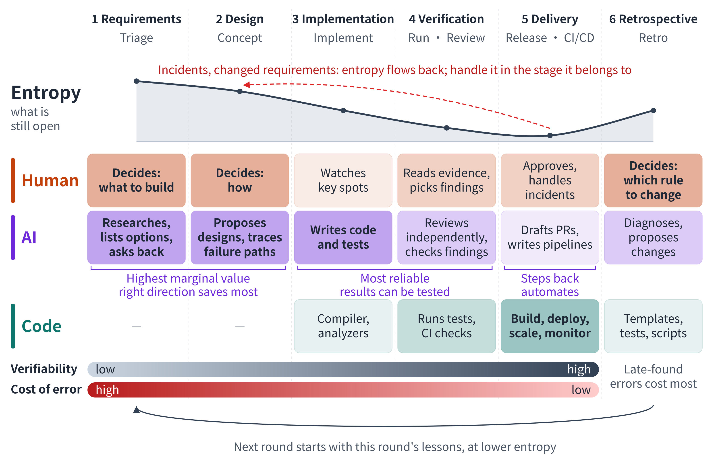

# Strategy and Tactics of Software Development in the AI Era

> Top-down: from a model of creation to a development process

[中文](README.zh.md) | Install the skills: [INSTALL.md](INSTALL.md)

I don't want a rulebook that needs patching every time a model gets better, so this text has two layers. The test is: if AI were ten times stronger, would the rule still hold? Rules that would are strategy and fill sections 1 to 3; rules that wouldn't are tactics and live in section 4. The test only covers quantitative change. If AI changes qualitatively, the strategy has to be derived again from scratch (section 5).

## 1. The model

The core of intellectual work is creation. Optimizing, iterating and fixing bugs are all forms and steps of it. Software development is the kind I know best, so I use it as the carrier here, but the model itself is not limited to software.

In software development, creation runs through six stages: requirements, design, implementation, verification, delivery, and retrospective. Other fields name them differently, but the structure is similar. I use "entropy" for how uncertain a stage still is: decisions not yet made, assumptions not yet tested, constraints not yet known. Each decision and each tested assumption lowers the entropy, so creating something means steadily reducing it. Entropy is highest at the start and the number of variables shrinks as you go; the more complex the work, the longer the early stages take. How much of it is design depends on the problem. Architecture work spends most of its time on concepts, while CRUD and other repetitive, simpler work needs few. Now that AI automates much of the CRUD, design takes a larger share of the whole.

Until recently this work had two productive forces: people and deterministic programs. Now there is AI as well. Where each one belongs follows from how they differ:

|                          | Human                    | AI                                   | Program                 |
| ------------------------ | ------------------------ | ------------------------------------ | ----------------------- |
| Can judge and trade off  | yes                      | yes                                  | no                      |
| Speed                    | slow                     | fast                                 | fastest                 |
| Same input, same output  | no                       | no (more stable with a precise prompt) | yes                   |
| Signals when it's wrong  | yes, hesitates           | no, equally confident when wrong     | stays wrong             |
| Can bear consequences    | yes                      | no                                   | no                      |
| Remembers last time      | yes                      | no, every session starts from zero   | hard-coded              |

AI can judge, like a person, and that is its biggest difference from a fixed program: for the first time, the parts of creation that need judgment can be handed to machines at scale. Like a program, though, it cannot bear consequences, so a person still makes the call. And like a person it is not deterministic, so work whose entropy is already low and that repeats is cheaper and more reliable as a program.

Putting the six stages of software development and the three productive forces together gives figure 1.

Figure 1: The role of AI across the stages of software development. The darker the cell, the more that force carries the stage.

First, AI's value and its reliability peak in different places. Entropy is highest early on, where research, divergent thinking and comparing designs cost the most effort, and choosing the right direction saves the most work. That is where AI's marginal value is highest. In the middle stages the task is clearly specified and the result can be compiled and tested, so that is where AI is most reliable. Many people think AI is best at writing code and tests because mistakes there show up at once, which makes it feel safe. The early stages are worth more, but no test raises an alarm when something goes wrong there, so the person needs judgment of their own and has to ask the AI for evidence.

Second, delivery is almost entirely in the hands of programs: building, deploying, scaling and copying cost next to nothing, people only approve and handle incidents, and the work concentrates in the first four stages. Design and coding are different activities. Design settles structure, invariants and trade-offs; coding implements them. Many CRUD programs barely need a separate design because it gets settled while writing the code, which makes it easy to believe coding is design. Once a system gets complex, design has to be done on its own, and finished before coding starts.

Third, the further along, the less AI does the work directly. Its job becomes turning repeated steps into scripts, tests and pipelines, and then leaving that part of the process.

Entropy does not always go down. Incidents and changed requirements push it back up, and the fix belongs in the stage the problem comes from; that is the red dashed line in the figure. The retrospective reopens questions, so entropy rises there; it also carries this round's lessons into the next, which then starts with less entropy. Finally, every stage is itself a small cycle of creation: designing an interface also involves research, design and verification. When dividing work, what counts is how much is still open in the task itself, not where it sits in the overall process.

## 2. Invariants

The properties in the AI column will change: it will get faster and remember more. The five points below will not, and the principles that follow are derived from the model and from them.

1. Consequences belong to people. When software fails, the people and their organization are the ones who explain and answer for it.
2. Checking your own work inside one set of assumptions cannot find the problems in those assumptions. That holds for people and for AI, regardless of ability.
3. Attention is limited. A person's energy is limited; AI's context keeps growing, but the more rules are loaded into it, the more they conflict with and dilute each other.
4. Whatever becomes cheap gets produced in bulk, including things that should not exist.
5. Upstream errors cannot be fixed downstream, and the later they are found, the more they cost. If the requirement is misunderstood, a perfect implementation is still wrong; if the design is wrong, patches in the code only multiply.

## 3. Seven principles

### 1. A person and their agent are one unit

Only people can bear consequences, so a person makes the call; most of the proposing, implementing and checking can go to AI. When something breaks, I look at where the unit failed: the AI judged wrong, the requirement was unclear, or information got lost in the handover. Whichever side caused it gets fixed.

AI proposals have to be closed: evidence, a recommendation and its cost, so the person can decide directly. An open question like "is this needed?" hands the homework back. The person, in turn, states requirements clearly and says so when they change their mind.

How far AI may act on its own is set by risk (principle 6). Local edits, builds and tests can run freely; actions that others can see and that are hard to undo, such as pushing, opening PRs or posting comments, I currently keep for myself, and AI only drafts them. Many people let AI take low-risk actions directly, and that is reasonable too.

### 2. Evidence only

Consequences belong to people, and a person who signs off on a result needs something they can check. AI also gives no signal when it is wrong, so its "done" or "all tests pass" says nothing by itself. What counts is something checkable, such as test output or a screenshot.

Pointing out a problem takes evidence as well: follow the call chain to the end and state which invariant breaks under which conditions. "Looks like a known bad pattern" is only a lead. Requirements need a source too, and a pattern borrowed from elsewhere gets one question: does its original reason hold here?

### 3. Review must be independent

The author's context is full of the author's assumptions, and self-review inside it only finds problems the author already thought of. AI makes independent review cheap: open a new context and give it only the requirements, design, conventions and the change, not the author's thinking. It costs about as much as a self-review, so I do it at every risk level.

Reviewers make mistakes too. Each finding is first verified by a second agent or a small experiment, then handed to a person to choose from. Decisions already made go to the reviewer together with their reasons and are not reopened without new evidence.

### 4. Converge, or go back

Fixes should leave fewer problems each round. When new problems keep appearing in the same area, rounds pile up, the change grows larger than the problem, or tests start getting changed to pass, an upstream assumption is wrong. Stop, name the assumption, and go back to the stage it belongs to: a wrong "what" goes back to requirements, a wrong "how" back to design.

Some loops have to be closed by hand. AI review can always find something new, and some of it is wrong, so a review needs an end defined in advance: once the chosen findings are fixed, it closes, and only changes made after that get reviewed. This rule came after one PR whose review kept growing.

### 5. Every part needs a reason to exist

"Too much trouble" used to filter out a lot of nice-to-have code, and AI has removed that filter. More parts mean more to maintain and more that can break, so the order, borrowed from Musk, is: ask who wants the requirement, delete, simplify, and only then optimize.

Whether something can go depends on what concrete failure happens without it, and you have to be able to point to that path; "rare" and "just in case" don't count. We once wrote a fix twice for a state the application could never reach, then reverted all of it. This test applies to my own ideas, and to tests as well: don't test the behavior of frameworks and libraries, because those tests never fail because of our mistakes.

### 6. Spend attention by risk

AI writes faster than people can review, so a person can only decide where to look and how closely. Risk has two parts: how much a mistake would cost and how sure we are. The number of changed lines doesn't enter into it. Attention belongs on tasks with high entropy and expensive mistakes, and most of them are in the first two stages.

Review findings are graded by consequence and likelihood in the same way, and "no problems" is a normal review result.

### 7. The system learns

An agent does not get better from a single correction. What accumulates, and what people can inspect and change, are the rules, skills, templates, scripts and tests around it. They are changed so that people correct, re-explain and redo less later, without making every session carry more context. A written rule lowers the starting entropy of the next round; a template, test or script moves that judgment out of the human and AI rows into the program row.

When changing them, I keep to a few rules:

- Find the cause; a correction is only the symptom. Fix it where the fix is cheapest.
- A problem that happened once is usually not worth a rule.
- Every rule carries its reason, otherwise it can't be applied at the edges and nobody dares to delete it.
- What structure can enforce shouldn't depend on text.
- Check a new rule against the existing ones: merge overlaps, and for a conflict find the missing condition and write one rule.
- Every change is a hypothesis. If the problem it should have prevented happens again, go back and fix that rule.

## 4. Skills: one way to put it into practice

I currently run the process below with Copilot and a set of skills. The stages match figure 1, and the skills are in the [`skills/`](skills/) folder.

| Stage | Step | Exit condition | Principles |
| ----- | ---- | -------------- | ---------- |
| 1 Requirements | Triage | Risk, reason and hotspots clear; the "what" is clear, open questions answered by their owner | 6, 1 |
| 2 Design | Concept (only when the "how" is unclear) | Closed design agreed; decisions with trade-offs recorded as ADRs | 5, 4 |
| 3 Implementation | Implement | Code and tests implement the design, nothing more; a bug fix starts with a failing test | 5, 2 |
| 4 Verification | Run | Build and tests pass, the API is called when behavior changed; output shown | 2 |
|  | Blind review | A sub-agent in a fresh context reviews, at every risk level | 3 |
|  | Close review | Each finding verified, a person picks, fixes done, review closed | 3, 4, 1 |
| 5 Delivery | Commit, PR, PR review | AI drafts, a person commits and publishes | 1 |
|  | CI/CD | Not covered by the skills; entirely programs | none |
| 6 Retrospective | Retro | Friction turned into proposals; for a problem found late, ask which step should have caught it and fix that step | 7 |

A few more things:

- One folder per task. `Status.md` holds the current step, scope, decisions and follow-ups and is the agent's state across sessions; the developer's own design notes live in the same folder.
- ADRs record only design decisions with trade-offs, fit on one screen, and must list each option's downsides and the accepted cost. Once accepted, an ADR is not rewritten; a changed decision gets a new one.
- Review findings are graded with a consequence x likelihood matrix; the details are in `branch-review`.
- Work can start in the middle: "review this PR" goes straight to blind review. A person can skip or change any step and states the reason once when skipping.

| Skill | Purpose |
| ----- | ------- |
| `ai-dev-steps` | Orchestration: steps, exit conditions, where records go |
| `ticket-triage` | Short pre-coding assessment: risk, hotspots, whether a design is needed |
| `concept` | Build or challenge a design: invariants, deletion, closing the loop, options |
| `adr` | Record and look up design decisions |
| `branch-review` | Review a branch or PR, including the rating rules and risk matrix |
| `pr-comments` | Triage PR comments and draft replies |
| `retro` | How the system learns from experience |

## 5. Change: quantitative and qualitative

Section 4 will go out of date sooner or later. Sections 1 to 3 say why things are done this way, and as long as AI changes only quantitatively, what changes are the parameters:

- If AI makes fewer mistakes, reviews can be lighter and shorter; places where mistakes are expensive still need a person.
- With longer context and better memory, external records like `Status.md` may become unnecessary, but for the system to learn, the lesson still has to be written down somewhere with its reason.
- Which model a sub-agent uses and how it is configured will change; that a context cannot review itself will not.
- Replacing Copilot with another agent may require adapting section 4, but sections 1 to 3 stay as they are.
- The cheaper code gets, the more principle 5 matters.

The stronger AI gets, the more people's decisions concentrate on designs and goals.

These principles are valid until AI's next qualitative change. Enough quantitative change turns into qualitative change at some point, and I can't predict when that will happen or what it will look like. When it does, even the invariants in section 2 may fail, and the whole text has to be derived again from the model. These are the signals I watch for:

- AI starts giving reliable signals when it is wrong, knowing what it doesn't know. Principle 2 can then be relaxed a lot.
- AI can bear consequences, whether legally, through insurance or within organizations. Invariant 1 no longer holds and principle 1 needs rewriting.
- AI output becomes deterministic and auditable, and the line between AI and programs disappears. The table of the three productive forces has to be redrawn.

## 6. Limits

- The process has a cost. Running all of it for a two-line text change is waste; trim it by risk (principle 6).
- It grew out of a multi-service backend project with a small team, where mistakes are fairly expensive. Exploratory prototypes and one-off scripts need little of it.
- It depends on human judgment. Principle 1 assumes the person understands what the AI proposes; someone who doesn't know the domain won't see the problem even with the evidence in front of them.
- Rules age too. Look back now and then at which ones still help and which nobody needs anymore.
