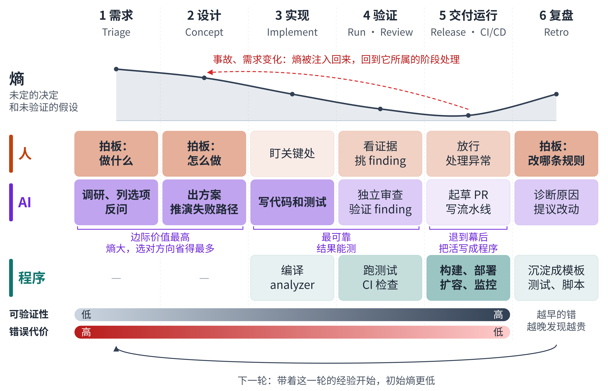

# AI 时代，软件开发的战略和战术

> 自上而下：从创造的模型推到开发流程

[English](README.md) | 安装 skills：[INSTALL.md](INSTALL.md)

我不想要一份每次模型升级都得打补丁的规则，所以把内容分成战略和战术两层，判断标准是：如果 AI 再强十倍，对应的规则是否还会成立。还成立的算战略，写在前三节；会变的算战术，写在第四节。这个标准只管量变，AI 一旦发生质变，战略也得从头推一遍，见第五节。

## 一、模型

智力工作的核心是创造：优化、迭代、修 bug 都是创造的具体形式和步骤。软件开发是我最熟悉的一种，下面拿它当载体，本文的建模本身并不限于软件。

放到软件开发里，创造大致分六个阶段：需求、设计、实现、验证、交付运行、复盘。别的领域叫法不同，结构类似。我用“熵”来描述一个阶段的不确定性：没做的决定，没验证的假设，不知道的约束。每做一个决定、验证一个假设，熵就少一点，创造就是不断降熵的过程。开始时熵最高，越往后变量越少；越复杂的创造，前期花的时间越长。设计占多少要看问题本身：架构类的工作大部分时间花在 concept 上，CRUD 等重复性高、较简单的工作则较少需要 concept；AI 把大量 CRUD 自动化以后，设计在整个工作里的比例就上升了。

以前做这些事的只有两种生产力：人和确定性的程序。现在多了 AI。三者的区别决定了它们各自该放在哪里：

|                    | 人         | AI                       | 程序         |
| ------------------ | ---------- | ------------------------ | ------------ |
| 能判断/取舍        | 能         | 能                       | 不能         |
| 速度               | 慢         | 快                       | 最快         |
| 同样输入，同样输出 | 否         | 否（prompt 越具体越稳定）             | 是           |
| 出错时有没有信号   | 有，会犹豫 | 没有，错了也一样自信     | 错了就一直错 |
| 能承担后果         | 能         | 不能                     | 不能         |
| 记得上一次         | 记得       | 不记得，每个会话从零开始 | 写死在代码里 |

AI 和人一样能判断，这是它和固定化程序最大的区别，创造中需要判断的那部分第一次可以大规模交给机器。但它和程序一样不能承担后果，所以拍板的还是人。它也和人一样不确定，熵已经很低、要反复做的活，交给程序更便宜，也更可靠。

把软件开发的六个阶段和这三种生产力放在一起，就是图 1。

图 1：AI 在软件开发各阶段的作用。格子颜色越深，越是这个阶段的主力。

第一，AI 的价值和可靠性不在同一个地方。前期熵最大，调研、发散、比较方案最费人力，选对一个方向省下的工作也最多，所以 AI 在这里的边际价值最高。中期任务已经说得清楚，结果可以编译、可以测试，AI 在这里最可靠。很多人觉得 AI 最擅长写代码和写测试，是因为在那里出错能马上发现，用着放心。前期价值更大，但出错时没有测试报警，人必须自己有判断力，并且要求 AI 拿出证据。

第二，交付运行几乎全交给了程序：构建、部署、扩容、复制几乎不花钱，人在这里只负责放行和处理异常，工作量集中在前四个阶段。设计和编码是两件事，设计定下结构、不变量和取舍，编码负责实现。很多 CRUD 程序几乎用不着专门设计，写代码时顺手就定了，所以容易让人以为编码就是设计；系统一复杂，设计就得单独做，而且要在编码之前做完。

第三，越往后，AI 越少直接干活。它的作用变成把重复的步骤写成脚本、测试和流水线，然后退出这部分流程。

熵也不总是往下走。事故、需求变化会把熵注入回来，这时要回到它所属的阶段去处理，就是图中那条红色虚线。复盘会重新打开问题，熵回升；它把这一轮的经验带进下一轮，下一轮开始时的熵就低一些。另外，每个阶段内部又是一个小的创造循环，设计一个接口也要调研、设计、验证，所以分配工作时要看这件事本身还有多少没定，它在大流程里排第几步没那么重要。

## 二、不变量

表格里 AI 那一列的属性会变，它会更快，也会记得更多。下面五条不会变，后面的原则都是从模型和这五条推出来的。

1. 后果归人。软件出了问题，要解释、要担责的是人和他所在的组织。
2. 在同一套假设里检查自己的工作，查不出这套假设本身的问题。人是这样，AI 也是这样，和能力高低没有关系。
3. 注意力有限。人的精力有限；AI 的上下文在变长，但加载进去的规则越多，它们越容易互相冲突、互相稀释。
4. 东西一便宜就会被大量生产，其中也有不该存在的。
5. 上游的错误在下游修不好，而且发现得越晚越贵。需求理解错了，实现得再好也是错的；方案错了，代码里的补丁只会越打越多。

## 三、七条原则

### 1. 人和 agent 是一个整体

后果只能由人承担，所以拍板的是人；提议、实现、检查，大部分可以交给 AI。出了问题，看的是这个整体哪里坏了：AI 判断错了，需求没说清，或者信息在交接时丢了，哪边的问题就改哪边。

AI 的提议要闭合，带上证据、推荐和代价，让人能直接拍板；“这个需要吗？”这种开放问题，等于把功课推回给人。人要把需求说清楚，改了主意要说明。

AI 能直接做到哪一步，按风险定（原则 6）。本地编辑、构建、测试可以放手；push、发 PR、发评论这类别人看得见、难撤回的动作，我目前都留给自己，AI 只起草。很多人对低风险的动作直接让 AI 做，这也说得通。

### 2. 只认证据

后果归人，人要为结果签字，手里就得有能检查的东西。AI 出错时又没有信号，它说“做完了”“测试都过了”，这句话本身说明不了什么，算数的是测试输出、截图这类能检查的产物。

指出问题同样要证据，要顺着调用链追到底，说清哪条不变量在什么情况下会被破坏，“看起来像某种坏模式”只是线索。需求也要有出处，从别处借来的模式要问一句：当初的理由在这里还成立吗？

### 3. 审查要独立

作者的上下文里装满了作者的假设，在里面自查，只能查出作者想到过的问题。AI 让独立审查变得便宜：新开一个上下文，只给它需求、设计、约定和改动，不给作者的想法，成本和作者自查差不多，所以我在每个风险等级都做。

审查者也会错，每条 finding 先由第二个 agent 或一个小实验验证，再交给人挑。已经定下的决策连同理由一起交给审查者，没有新证据就不重开。

### 4. 收敛，否则回溯

修补应该让问题越来越少。如果同一块地方反复冒出新问题，轮次越来越多，改动比问题还大，或者开始为了让测试通过去改测试，说明错的是上游的某个假设。这时要停下来，说出是哪个假设，回到它所属的阶段：做什么错了回到需求，怎么做错了回到设计。

有些循环要人为关掉。AI 审查永远找得出新问题，其中一些是错的，所以审查要预先定好终点：选中的问题修完就关闭，之后只看增量。这条规则是在一个越审越大的 PR 之后加上的。

### 5. 每个部件都要有存在的理由

“太麻烦”曾经替我们挡掉很多可有可无的东西，AI 把这道过滤器拆了。部件越多，维护和出错的面就越大，所以顺序借自马斯克：先问需求是谁提的，再删，再简化，最后才优化。

能不能删，看没有它会出什么具体故障，要能指出那条路径，“很少见”和“以防万一”都不算。我们曾经为一个根本走不到的状态写了两遍修复，最后全部回滚。这一关对我自己的想法同样适用，对测试也适用：不测框架和库的行为，那些测试永远不会因为我们写错而失败。

### 6. 按风险分配注意力

AI 写得比人审得快，人只能决定在哪里看、看多深。风险看两样：错了代价多大，我们有多少把握，跟改了多少行无关。人的注意力该放在熵高、错了代价大的事情上，这类事大多在前两个阶段。

审查意见也按后果和可能性分级，“没问题”是一个正常的审查结果。

### 7. 学习的是系统

agent 不会因为一次纠正就变好，能积累下来、人能检查和修改的，是它周围的规则、skills、模板、脚本和测试。改它们是为了让人以后少纠正、少重复解释、少返工，同时别让每个会话多背上下文。写成规则，下一轮的初始熵就低一些；做成模板、测试或脚本，这部分判断就从人和 AI 移到了程序那一行。

改的时候守这几条：

- 先找原因，一次纠正只是表象，在改起来最省事的地方改。
- 只发生一次的问题，通常不值得写成规则。
- 每条规则带上理由，否则到了边缘情况没法判断，也不敢删。
- 能用结构保证的，就别靠文字。
- 新规则先和旧规则对一遍：重叠就合并，冲突就找出缺的那个条件，合成一条。
- 每次修改都是一个假设，同样的问题再发生，就回去改那条规则。

## 四、Skills：一种落地方式

我现在用 Copilot 加一组 skills 跑下面这套流程，阶段和图 1 一一对应，skills 都在 [`skills/`](skills/) 目录里。

| 阶段 | 步骤 | 退出条件 | 原则 |
| ---- | ---- | -------- | ---- |
| 1 需求 | Triage | 风险、理由和热点清楚；做什么清楚，开放问题由负责的人回答 | 6、1 |
| 2 设计 | Concept（只在“怎么做”不清楚时） | 方案闭合并获得同意；有取舍的决策写成 ADR | 5、4 |
| 3 实现 | Implement | 代码和测试实现方案，不多不少；修 bug 先写一个会失败的测试 | 5、2 |
| 4 验证 | Run | 构建和测试通过，行为有变化就真的调一次 API；输出贴出来 | 2 |
|  | Blind review | 新上下文里的 sub-agent 审一遍，每个风险等级都跑 | 3 |
|  | Close review | 每条 finding 经过验证，人挑选，修完，关闭 | 3、4、1 |
| 5 交付运行 | Commit、PR、PR Review | AI 起草，人提交和发布 | 1 |
|  | CI/CD | 不归 skills 管，全部是程序 | 无 |
| 6 复盘 | Retro | 摩擦变成改进提议；问题发现得晚，就问哪一步本该抓住它，去改那一步 | 7 |

另外几件事：

- 每个任务一个文件夹。`Status.md` 记录当前步骤、范围、决策和后续事项，是 agent 跨会话的状态；开发者自己的设计笔记也放在同一个文件夹里。
- ADR 只记录有取舍的设计决策，控制在一屏以内，必须写出各个选项的缺点和最终接受的代价。状态变成 Accepted 以后就不再改写，决策变了另写一份。
- 审查意见按“后果 x 可能性”的矩阵分级，细则在 `branch-review` 里。
- 可以从中间开始，比如“review 这个 PR”直接从 Blind review 进入。人可以跳过或改动任何一步，跳过时说一次理由。

| Skill | 作用 |
| ----- | ---- |
| `ai-dev-steps` | 总调度：步骤、退出条件、记录放在哪里 |
| `ticket-triage` | 编码前的简短评估：风险、热点、要不要先做设计 |
| `concept` | 建立或挑战一个方案：不变量、删减、闭环、选项 |
| `adr` | 记录和查阅设计决策 |
| `branch-review` | 审查分支或 PR，含评分标准和风险矩阵 |
| `pr-comments` | 分类处理 PR 评论，起草回复 |
| `retro` | 系统怎样从经验里学习 |

## 五、变：量变和质变

第四节迟早会过时。前三节写的是为什么这么做，只要 AI 还是量变，变的只是其中的参数：

- AI 出错少了，审查可以浅一点、少几轮；后果重的地方还是要人看。
- 上下文更长、记忆更好以后，`Status.md` 这类外部记录也许就用不着了，但要让系统学到东西，总得把它连同理由写在某个地方。
- sub-agent 选什么模型、怎么配置会变，同一个上下文审不了自己这一点不会变。
- 把 Copilot 换成别的 agent，第四节可能要适配，但前三节不受影响。
- 代码越便宜，原则 5 越要紧。

AI 越强，人做决定的位置越往方案和目标集中。

这些原则的有效期，是到 AI 的下一次质变为止。量变积累到某个点会变成质变，我预测不了那一天什么时候来，也预测不了它是什么样子。到那时，连第二节的不变量都可能失效，整篇要从模型开始重新推。我会盯着下面几个信号：

- AI 出错时开始有可靠的信号，知道“自己不知道”。原则 2 可以大幅放松。
- AI 能够承担后果，不管是在法律上、保险上还是组织上。不变量 1 不再成立，原则 1 要重写。
- AI 的输出变得确定、可审计，和程序的界限消失。三种生产力的那张表要重画。

## 六、边界

- 流程本身有成本。改两行文案还走全套就是浪费，要按风险裁剪（原则 6）。
- 这套做法是在一个多服务的后端项目里形成的，团队只有几个人，出错的代价比较高。做探索性原型或者写一次性脚本，大部分步骤用不上。
- 它依赖人的判断。原则 1 默认人看得懂 AI 的提议，如果人不懂这个领域，证据摆在眼前也看不出问题。
- 规则也会过时，要隔一段时间回头看看哪些还有用、哪些已经没人需要了。
